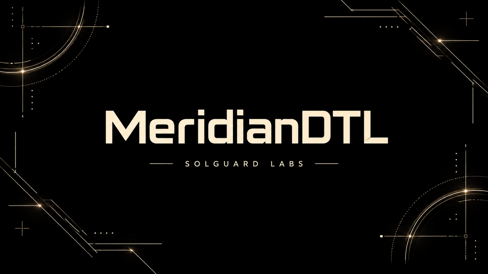
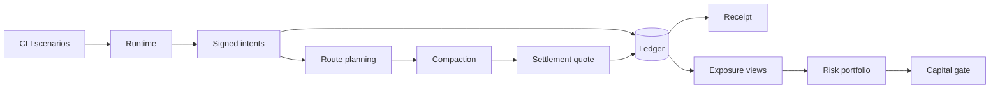
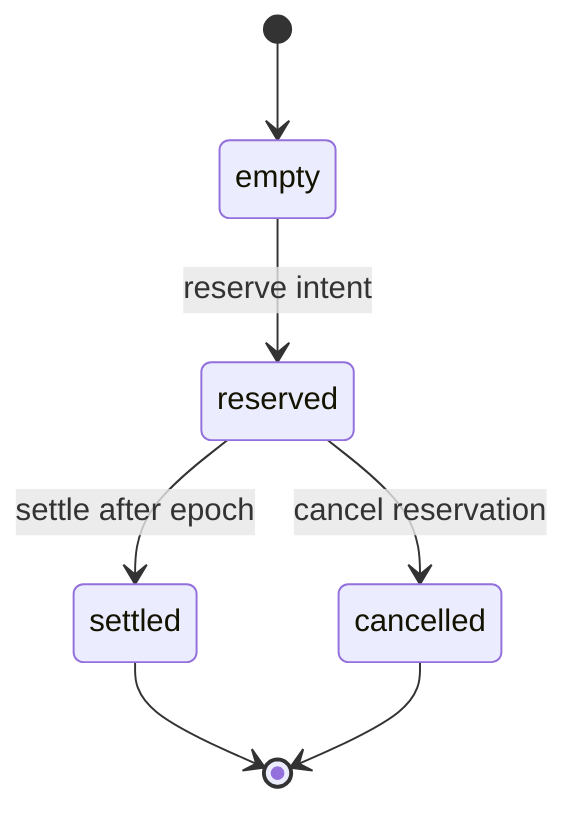
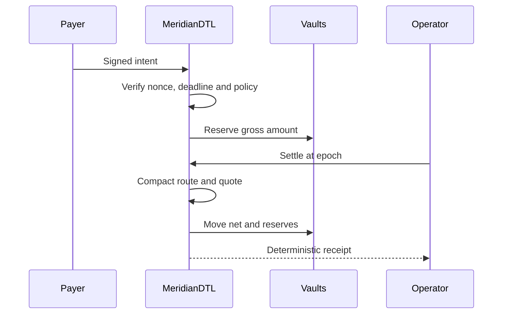

# MeridianDTL



[](https://github.com/SolguardLabs/MeridianDTL/actions/workflows/ci.yml)
[](https://github.com/SolguardLabs/MeridianDTL/actions/workflows/release-integrity.yml)
[](https://www.open-std.org/jtc1/sc22/wg14/)
[](https://github.com/SolguardLabs/MeridianDTL/releases/tag/v1.0.0)

MeridianDTL es un motor determinista de liquidación en C11 para intenciones firmadas y rutas multi-hop entre bóvedas internas. Coordina reservas, compactación de rutas, tarifas, receipts por epoch y settlement sobre un ledger local con conservación verificable.

La versión 1.0.0 añade un modelo independiente de riesgo de cartera: pérdida esperada, stress de default, gap de liquidez, concentración HHI, capital objetivo y decisiones operativas `approve`, `review` o `hold`.

## Capacidades

- Intenciones y receipts con dominios criptográficos separados.
- Ledger de cuentas, activos, bóvedas, lanes, reservas y journal.
- Rutas multi-hop compactadas de forma determinista.
- Tarifas de operador y reserva calculadas en puntos básicos.
- Control de nonces, epoch, límites y conservación de suministro.
- Exposición por lane y bóveda, con digests reproducibles.
- Capital bajo perfiles operativo y severo.
- CLI JSON estable y suites C/JavaScript.

## Arquitectura







## Modelo económico

Para un importe bruto \(G\), tasa de operador \(f_o\) y reserva \(f_r\):

```text
operator_fee = floor(G × f_o / 10 000)
reserve_fee  = floor(G × f_r / 10 000)
net_amount   = G - operator_fee - reserve_fee
```

El modelo de riesgo calcula por lane:

```text
expected_loss = pending × probability_default × (1 - recovery)
stressed_loss = pending × scenario_default
liquidity_gap = max(pending - liquidity × (1 - haircut), 0)
```

Y agrega:

```text
required_capital = max(expected_loss, stressed_loss)
                 + liquidity_gap + fee_reserve + concentration_addon
target_capital   = required_capital × minimum_coverage
```

Los detalles y ejemplos están en [docs/modelo-economico.md](./docs/modelo-economico.md) y [docs/riesgo-y-capital.md](./docs/riesgo-y-capital.md).

## Inicio rápido

Requisitos: compilador C11, `make`, Node.js 24 y npm.

```bash
npm ci
make all
make test-c
npm test
```

Ejecutar rutas:

```bash
./build/meridiandtl direct
./build/meridiandtl routed
./build/meridiandtl epoch-batch
./build/meridiandtl recompact
```

Evaluar la cartera:

```bash
./build/meridiandtl risk-portfolio
```

La salida compara el perfil operativo con el severo e incluye capital requerido, cobertura, déficit o superávit, concentración y digest.

## Escenarios

| Escenario        | Propósito                                   |
| ---------------- | ------------------------------------------- |
| `direct`         | Settlement de una lane directa              |
| `routed`         | Liquidación multi-hop                       |
| `epoch-batch`    | Reservas independientes por epoch           |
| `recompact`      | Compactación de hops compatibles            |
| `rejections`     | Rechazos de nonce, deadline y estado        |
| `operations`     | Economía de lanes, cancelación y exposición |
| `risk-portfolio` | Stress, concentración y capital             |

## Componentes

| Ruta               | Responsabilidad                           |
| ------------------ | ----------------------------------------- |
| `include/meridian` | Contratos públicos C                      |
| `src/intent.c`     | Intenciones, reservas, quotes y receipts  |
| `src/route.c`      | Planes, hops, digests y compactación      |
| `src/ledger.c`     | Estado contable y conservación            |
| `src/risk.c`       | Cartera, stress y capital                 |
| `src/runtime.c`    | Escenarios JSON                           |
| `tests/c`          | Pruebas matemáticas C                     |
| `tests/node`       | Contratos de integración sobre el binario |

## Validación

```bash
npm run ci
```

La puerta ejecuta compilación con `-Wall -Wextra -Werror -pedantic`, pruebas C, escenarios de humo, sintaxis JavaScript, integración, Prettier, métricas, control terminológico e integridad del release. GitHub Actions repite los contratos en Linux y Windows.

## Documentación

- [Arquitectura](./docs/arquitectura.md)
- [Modelo económico](./docs/modelo-economico.md)
- [Riesgo y capital](./docs/riesgo-y-capital.md)
- [Operación](./docs/operacion.md)
- [Integración](./docs/integracion.md)
- [Seguridad](./SECURITY.md)
- [Contribución](./CONTRIBUTING.md)
- [Historial](./CHANGELOG.md)

## Licencia

MIT. Consulte [LICENSE](./LICENSE).
