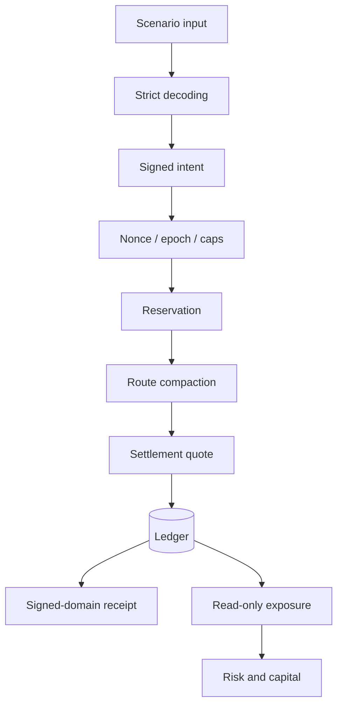
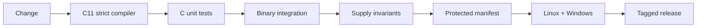

# Política de seguridad

MeridianDTL trata autorización, reservas y liquidación como límites de alta criticidad. Todo cambio económico requiere revisión, pruebas de conservación y evidencia reproducible.

## Versiones mantenidas

| Versión | Estado              |
| ------- | ------------------- |
| 1.0.x   | Estable y mantenida |
| < 1.0   | Fuera de soporte    |

## Límites de confianza

## Invariantes

- El suministro observado coincide con el emitido después de cada transición crítica.
- Una reserva solo se consume una vez y no puede liquidarse tras cancelación.
- El importe neto más las tarifas coincide con el importe bruto.
- Los nonces avanzan de forma monotónica dentro de su dominio.
- Las operaciones aritméticas detectan overflow y saldo insuficiente.
- Un reporte de riesgo nunca muta ledger, reserva, ruta o receipt.
- Los cálculos monetarios usan enteros y puntos básicos.

## Controles

- Compilación C11 con warnings tratados como errores.
- Pruebas unitarias para stress, recovery, HHI, cobertura y límites.
- Integraciones que ejecutan el binario real y validan JSON.
- Manifiesto de hashes para fuentes económicas protegidas.
- CI equivalente en Linux y Windows.
- Tag, versión, documentación y banner verificados antes del release.

## Reporte responsable

Use el canal privado de seguridad de GitHub. Incluya commit, plataforma, precondiciones, impacto económico, pasos mínimos, salida observada y propuesta de contención. No publique trazas sensibles antes de coordinar la corrección.

## Despliegue

El ejecutable modela un motor embebible; no aporta custodia de claves, autenticación de servicio, persistencia, consenso ni transporte seguro. La plataforma integradora debe proporcionar esas capacidades y conservar binario, entrada, salida y digest de cada operación.
