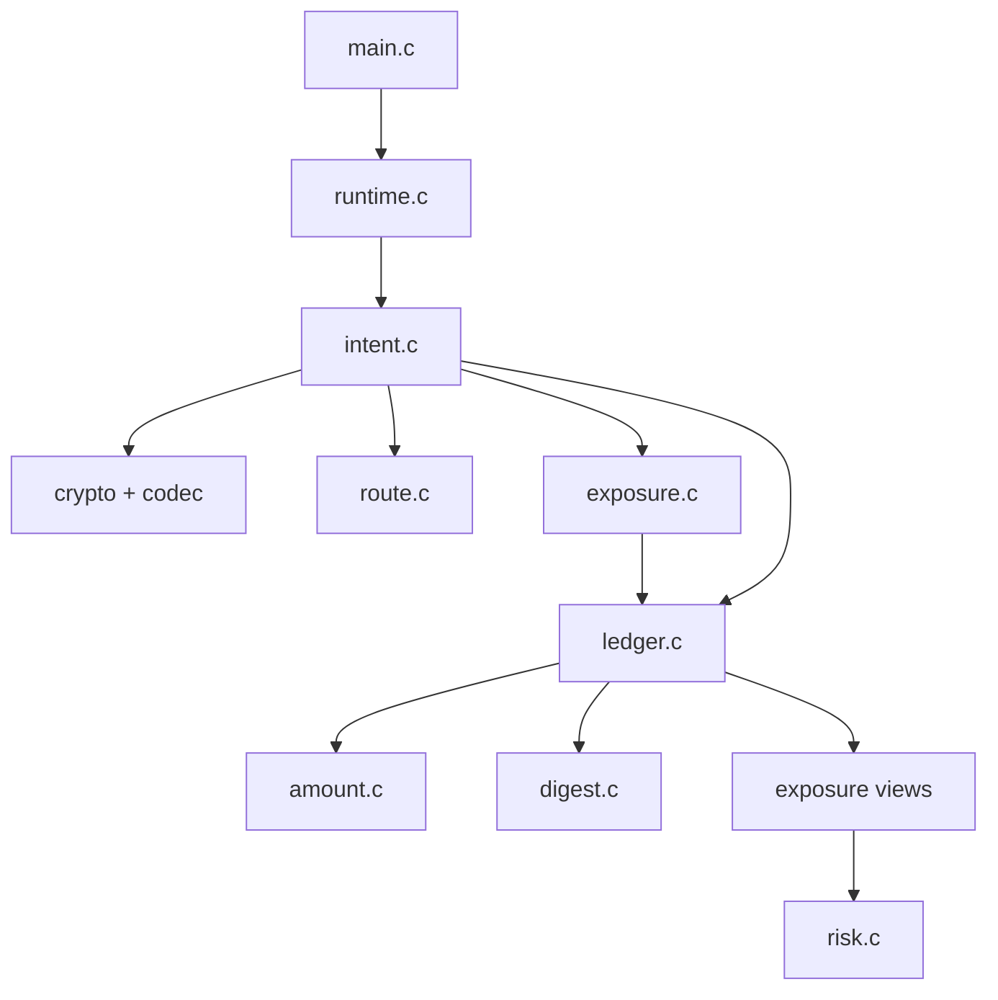
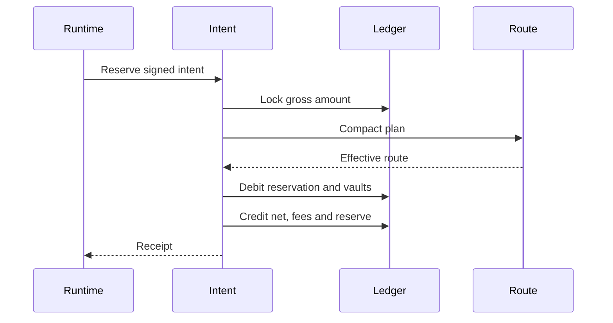

# Arquitectura

MeridianDTL separa serialización, identidad, rutas, ledger, runtime y riesgo. El core C no depende de red, sistema de archivos ni reloj; el epoch llega como dato explícito.

## Dominio

`MdLedger` contiene activos, cuentas, bóvedas, lanes, reservas, receipts y journal en arrays acotados. Los límites explícitos evitan asignación dinámica y hacen visible el coste máximo de una operación.

`MdSettlementPlan` describe hops, lane, beneficiario, operador, caps y epochs. `MdCompactedPlan` conserva la forma ejecutable. `MdReservation` inmoviliza el importe; `MdReceipt` materializa el resultado.

## Flujo

## Determinismo

- Arrays y recorridos tienen orden estable.
- Digests usan serialización canónica con dominios explícitos.
- No hay coma flotante ni fuentes aleatorias.
- La salida JSON conserva campos y orden.
- El riesgo recibe posiciones y devuelve un informe sin mutación.

## Extensión

Una regla económica nueva debe vivir en una función pura y devolver `MdStatus`. Debe validar punteros, límites, overflow y capacidad. Los adaptadores solo traducen entrada y salida; no deben duplicar cálculos del core.
