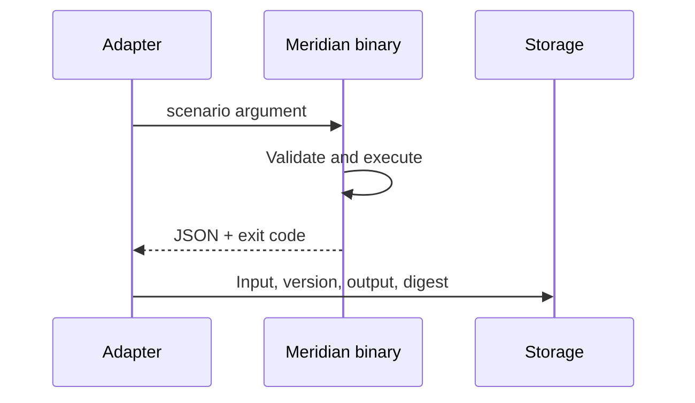

# Integración

MeridianDTL expone una CLI por escenarios. Cada ejecución escribe un único objeto JSON en `stdout` y errores en `stderr` con código de salida no cero.



## Contrato

Campos comunes: `scenario`, `network_id`, `asset`, `state_digest`, `total_supply`, `observed_supply`, `conservation_ok`, `balances`, `vaults` y `journal`. Los escenarios de settlement añaden `receipt` y `route`; el de riesgo añade `profiles.operating` y `profiles.severe`.

## Ejemplo Node.js

```js
import { execFile } from "node:child_process";

execFile("./build/meridiandtl", ["risk-portfolio"], (error, stdout) => {
    if (error) throw error;
    const report = JSON.parse(stdout);
    console.log(report.profiles.severe.decision);
});
```

## Compatibilidad

En una versión mayor estable, los campos existentes no cambian de significado. Pueden añadirse campos, por lo que el consumidor debe ignorar claves desconocidas. Estados y errores se amplían de forma aditiva.

## Seguridad del adaptador

No construya comandos mediante concatenación; pase argumentos al proceso. Limite tamaño, tiempo y concurrencia. Verifique el commit o checksum del binario, trate JSON como dato no confiable y no incluya claves privadas en escenarios o logs.
