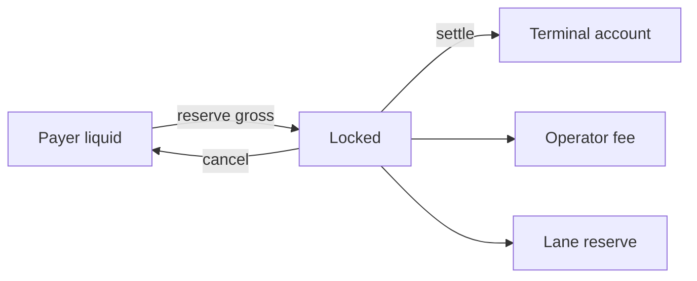

# Modelo económico

## Unidades

`MdAmount` es un entero sin signo de 64 bits. Los porcentajes usan `10 000 bps = 100 %`. `md_amount_add`, `md_amount_sub` y `md_amount_mul_bps` rechazan overflow o saldo insuficiente.

## Settlement



```text
operator_fee = floor(gross × operator_fee_bps / 10 000)
reserve_fee  = floor(gross × reserve_bps / 10 000)
net          = gross - operator_fee - reserve_fee
```

Para una lane de recuperación, `reserve_fee` suma la prima de exposición
calculada por [el modelo de recuperación](./recuperacion-y-exposicion.md).
La misma identidad de tres tramos se mantiene en el receipt.

La resta final conserva todos los residuos de redondeo en el neto y garantiza `gross = net + operator_fee + reserve_fee`.

## Bóvedas

Una bóveda expone `balance`, `pending_in`, `pending_out` y `available`. Durante reserva, el origen aumenta `pending_out` y los destinos reflejan entradas pendientes. Liquidar consume pendientes; cancelar los revierte.

## Conservación

```text
observed_supply = account_balances + vault_balances + locked_reservations
conservation_ok = observed_supply == issued_supply
```

Las tarifas no crean suministro: redistribuyen el importe reservado entre cuentas y bóvedas.

## Epoch

Una reserva contiene deadline y momento mínimo de settlement. El motor rechaza intentos anticipados, caducados, repetidos o incompatibles con su estado. Los nonces de intenciones y receipts permanecen separados.

## Ejemplo

Para `gross=120 000`, tarifa de operador `25 bps` y reserva `10 bps`:

```text
operator_fee = 300
reserve_fee  = 120
net          = 119 580
```
