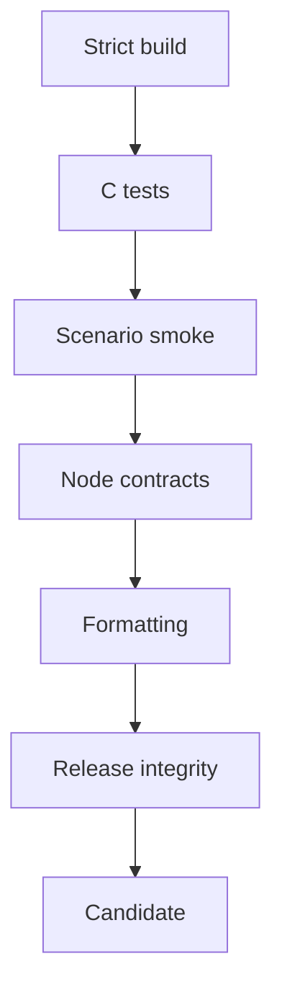

# Operación

## Puerta local

```bash
npm ci
npm run ci
```

En Windows con WSL puede usarse `powershell -ExecutionPolicy Bypass -File scripts/ci.ps1`. GitHub Actions usa compilación MinGW nativa para validar también el ejecutable Windows.



## Runbook

1. Conservar input, versión y epoch.
2. Ejecutar el escenario y archivar JSON.
3. Confirmar `conservation_ok` y los totales del receipt.
4. Revisar exposición de bóvedas y journal.
5. Ejecutar `risk-portfolio` con la política aprobada.
6. Escalar decisiones `review` o `hold` mediante doble control.

## Observabilidad

Registre versión, scenario, network ID, intent, reservation, receipt, route digest, state digest y risk digest. Alertas mínimas: fallo de conservación, capacidad agotada, nonce incorrecto, deadline vencido, déficit de capital y concentración sobre límite.

## Incidentes

Detenga nuevas reservas del activo afectado, conserve artefactos, reproduzca con el mismo commit, delimite cuentas y lanes, y publique una corrección con prueba de regresión. No modifique manualmente journal o receipts para reconciliar una ejecución.

## Release

`main`, `production` y `v2.0.0` deben apuntar al mismo commit. El tag es
anotado y el release se publica como `Production 2.0.0`. CI e integridad
deben pasar para candidato, PR, main, production, tag y evento de publicación.
