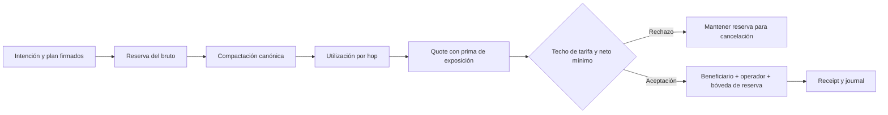

# Recuperación y exposición de ruta

Las lanes de recuperación admiten pagos bajo un coste de capital adicional al
de una liquidación ordinaria. La cuenta pagadora firma el plan de settlement,
incluidos hops, bóvedas, beneficiario, límites y epoch; el motor verifica ese
compromiso antes de inmovilizar el bruto. La reserva de exposición se calcula
durante el quote y se acredita a la bóveda de reserva de la lane.



## Unidades y redondeo

Para un hop `i`, `A_i` es el importe indicado, `V_i` el balance de su bóveda
origen, `w_i` el peso económico y `B = 10 000`:

```text
utilization_i = min(B, floor(A_i × B / V_i))
weighted_i    = floor(A_i × w_i / B)
charge_i      = floor(weighted_i × utilization_i / B)
route_charge  = Σ charge_i
reserve_fee   = floor(gross × lane.reserve_bps / B) + route_charge
net           = gross - operator_fee - reserve_fee
```

Las operaciones usan enteros sin coma flotante. El quote rechaza una bóveda
inactiva, sin balance, con importe indicado superior a su capacidad, o un peso
fuera de `0..10 000`. También rechaza el resultado si excede el techo de
tarifa o incumple el neto mínimo firmado.

Con un hop de `100 000` unidades, una bóveda de `500 000` y peso de `3 000`
bps, la utilización es `2 000` bps, el importe ponderado `30 000` y la prima
de ese hop `6 000`. Si la lane cobra `25` bps de operador y `20` bps de
reserva base, los tres tramos del quote son `250`, `6 200` y `93 550`.
Puede observarse el ciclo mediante `./build/meridiandtl recovery`.

## Integración y observabilidad

El adaptador debe conservar la intención firmada, digest del plan, reserva,
receipt, balances de bóvedas antes del quote y resultado del journal. En caso
de rechazo, no se debe fabricar un receipt alternativo fuera del motor.
La conciliación verifica que bruto, neto, tarifa de operador y reserva suman
exactamente el mismo importe, y que el suministro observado coincide con el
emitido. La [cartera de riesgo](./riesgo-y-capital.md) aporta una vista
complementaria, no una segunda fuente de autoridad de settlement.
