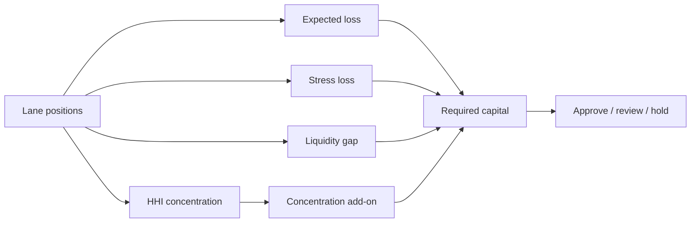

# Riesgo y capital

El módulo `risk` agrega posiciones independientes de lane. No lee ni modifica intenciones, rutas o ledger.



## Pérdida

```text
EL_lane = pending × PD × (1 - recovery)
stress_lane = pending × scenario_default
loss_charge = max(Σ EL_lane, Σ stress_lane)
```

Las dos multiplicaciones de EL se ejecutan por separado en puntos básicos, con redondeo entero tras cada etapa.

## Liquidez

```text
stressed_liquidity = available_liquidity × (1 - haircut)
gap = max(pending - stressed_liquidity, 0)
```

## Concentración

La cuota de una lane es su pendiente sobre el total. El índice HHI es `Σ share_bps² / 10 000`. El add-on carga solo la cuota que supera el umbral de diversificación.

## Perfiles

| Parámetro               |  Operativo |     Severo |
| ----------------------- | ---------: | ---------: |
| Default stress          |  1 500 bps |  4 200 bps |
| Haircut de liquidez     |  1 200 bps |  3 500 bps |
| Umbral de concentración |  2 500 bps |  2 000 bps |
| Add-on                  |  1 800 bps |  3 200 bps |
| Cobertura objetivo      | 12 500 bps | 16 000 bps |

## Ejemplo incluido

La cartera de cuatro lanes suma `1 000 000` pendiente. En operativo requiere `307 112` y queda aprobada con `600 000` de capital. En severo requiere `814 176`, su objetivo es `1 302 681`, el déficit es `702 681` y la decisión es `hold`.

El digest del informe cubre componentes, cobertura, concentración y decisión, permitiendo comparar ejecuciones.
